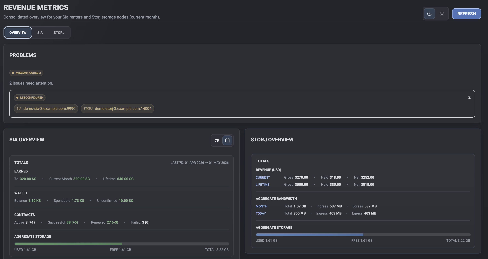
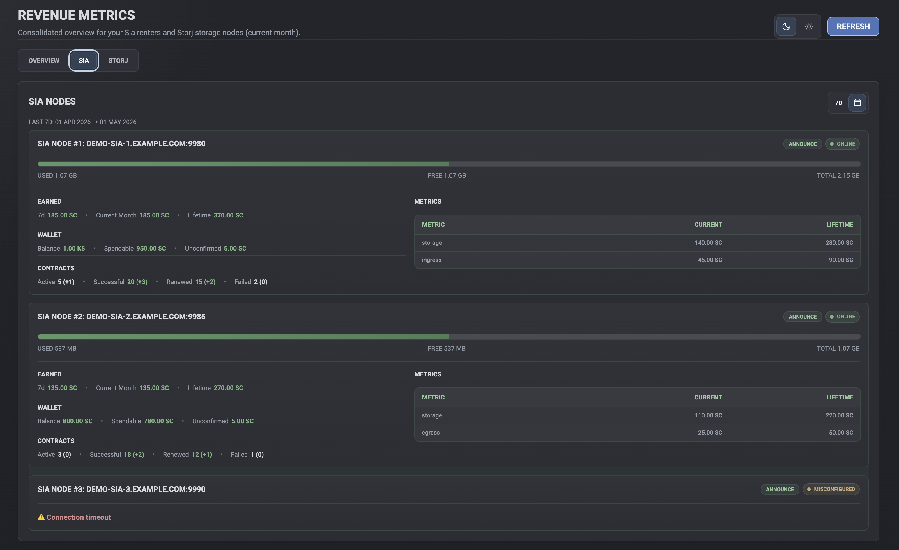
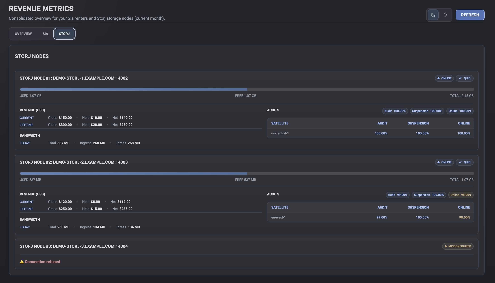

# StorageMan Dashboard

StorageMan is a NestJS dashboard for monitoring Storj storage nodes and Sia hosts from one local web UI. It proxies node APIs through backend endpoints, normalizes the responses, and presents revenue, storage, bandwidth, wallet, contract, and health metrics in a static dashboard served from the same app.

## Features

- Unified overview for Storj and Sia node performance.
- Per-node status, revenue, storage usage, and bandwidth metrics.
- Sia wallet and contract summaries with configurable date ranges.
- Storj payout, held amount, distributed amount, audit, QUIC, and disk summaries.
- Static frontend served by NestJS with API endpoints at `/api/storj` and `/api/sia`.

## Screenshots



*Overview dashboard with Storj and Sia aggregate metrics.*



*Sia dashboard view showing node storage, earnings, wallet, and contracts.*



*Storj dashboard view showing payout, disk, bandwidth, and audit data.*

## Getting Started

1. Install dependencies (requires Node.js 20.11.1 or a later 20.x, or 22 or newer: the range the locked dependencies support, declared in `engines` in `package.json`; CI runs Node.js 24 LTS):

   ```bash
   npm install
   ```

2. Configure environment variables:

   Copy `.env.example` to `.env` and fill in your private values.

   - `STORJ_NODES_JSON` – Preferred option. JSON array of Storj node configs. Today each entry only needs `host`. Wrap the JSON in single quotes in `.env`.
   - `SIA_NODES_JSON` – Preferred option. JSON array of Sia node configs with `host`, optional `username`, optional `password`, and optional `walletHost`. Wrap the JSON in single quotes in `.env`.
   - Legacy flat env vars still work as fallback, but the public config format is the JSON form above.
   - `NODE_REQUEST_TIMEOUT_MS` – Optional. Time limit for each request to a node (default `30000`). A node that does not answer in time is shown as Offline instead of holding up the whole dashboard.
   - `PORT` – Optional. Port of the dashboard (default `3000`).
   - `TLS_CERT_FILE`, `TLS_KEY_FILE` – Optional. Paths to a PEM certificate and private key. With both set, the dashboard itself is served over https; with neither it stays http. Setting only one stops the server at startup. See [Serving the Dashboard over HTTPS](#serving-the-dashboard-over-https).

   The server loads `.env` automatically at startup.

3. Run the application:

   ```bash
   npm run start:dev
   ```

   The server listens on `http://localhost:3000` (or `https://` with `TLS_CERT_FILE` and `TLS_KEY_FILE`) and serves the UI from `/`.

## Node Addresses and HTTPS

Every node address (`host` of a Storj or Sia node and a Sia `walletHost`) uses one format:

| Address | Requests go to |
| --- | --- |
| `192.168.1.5:14002` | `http://192.168.1.5:14002` (a bare `host:port` is always http, as before) |
| `https://storj.example.com:8443` | `https://storj.example.com:8443` |
| `https://storj.example.com` | `https://storj.example.com:443` (with a scheme the port defaults to the scheme's port) |
| `http://192.168.1.5` | `http://192.168.1.5:80` |
| `[fd00::5]:9980` | `http://[fd00::5]:9980` (IPv6 addresses go in brackets) |
| `https://[fd00::5]:9980` | `https://[fd00::5]:9980` |
| `https://[fd00::5]` | `https://[fd00::5]:443` |

Without a scheme the port is required: a bare host such as `192.168.1.5` or `storj.example.com` is invalid. With `https://` or `http://` the port may be left out and is then 443 or 80; a node's API usually has its own port (Storj 14002, hostd 9980), so leave it out only for a node behind a reverse proxy on the standard port. An address that cannot be read (a bare host without a port, a path, user credentials, a scheme other than http/https, or a host that the WHATWG URL parser of Node.js fetch and browsers does not give back exactly as written, ignoring case: a name whose last label is a number is read as an IPv4 address there, so only four decimal parts from 0 to 255 without leading zeros pass, and `192.168.1.300`, `host.123`, `1.2.3` (read as 1.2.0.3), `010.0.0.1` (read as 8.0.0.1) and `192.168.1.05` (read as 192.168.1.5) are all rejected, and so is an `xn--` label that is not valid Punycode on the Node.js versions whose parser rejects it (newer ones may accept and request it as written); an IPv6 address comes back in canonical form, so its text is not compared, and it is rejected only when the parser rejects it, which for an address of the form above happens only to a dotted IPv4 tail with a leading zero such as `[::ffff:192.168.1.05]`) marks the node as misconfigured (`errorKind: invalid_endpoint`) and is never requested; the error message does not repeat the address, and user credentials in it are masked (`***@host:port`) wherever the address is shown. A Sia `walletHost` that cannot be read does not fail the node: it is skipped, the wallet comes from hostd as when the wallet service is down, and the server logs a warning once (without the address). Earlier versions requested such a value as `http://<value>`, e.g. a host without a port on port 80: write `host:80` or `http://host` instead.

- hostd's API password is sent as HTTP Basic auth on every Sia request. Over plain http anyone on the network path can read it, so use `https://` (for example a TLS reverse proxy in front of hostd) or a VPN for nodes outside your own network.
- A node behind a certificate from a private CA or a self-signed certificate needs that CA trusted by Node.js: start the server with `NODE_EXTRA_CA_CERTS=/path/to/ca.pem` in its environment, e.g. `NODE_EXTRA_CA_CERTS=/path/to/ca.pem npm run start:prod`. Node.js reads it only at startup, so it cannot go in `.env`. Without it the node is shown as misconfigured with a certificate error.

## Serving the Dashboard over HTTPS

The dashboard itself is served over plain http unless both `TLS_CERT_FILE` and `TLS_KEY_FILE` point to PEM files, in `.env` or in the server's environment:

```env
TLS_CERT_FILE=/etc/storageman/fullchain.pem
TLS_KEY_FILE=/etc/storageman/privkey.pem
```

- The certificate file holds the server certificate followed by any intermediate certificates. The key must not be encrypted: no passphrase is passed.
- The server keeps listening on `PORT` (default `3000`); https does not move it to 443.
- Both files are read once at startup, so restart the server after changing these variables or renewing the certificate (node settings in `.env`, by contrast, are re-read while it runs). A missing or unreadable file stops the server at startup, as does setting only one of the two variables.
- This is separate from the node addresses: `https://` nodes are requested over https whether or not the dashboard itself is.

## How Figures Are Computed

- **Storj lifetime** – Paystubs (`/api/heldamount/paystubs`) for every month that has one, plus the estimated payout of the months no paystub covers yet (the current month, and the previous one until its paystubs are complete: until every satellite with a paystub two months back has one for it too, since storagenode fetches them one satellite at a time every 12 hours and the satellites publish them hours apart). A new node's empty paystub range comes back as `null` and counts as no paystubs. Net is what the satellites released for payment, as the storagenode dashboard's "Total Earned": the paystubs' `paid` (earned after the held amount was withheld, held amount returned included). Held is the amount still withheld (held minus held amount returned, the dashboard's "Total Held Amount"), and gross is net plus held (the dashboard's paid + held - disposed per month). `owed` (earned - held + disposed) is not used: a month the satellites hold back keeps its `owed` but records `paid` 0, and counts once it is recorded as paid. The 2026-07 paystubs are such months: Storj's Chapter 11 court hold of July 1-26, 2026. `distributedUsd` (shown as "Distributed") is what the satellites actually transferred; it can include amounts carried over from earlier months below the payout threshold and, since August 2026, the prepayment of the next month (on the 2026-07 paystubs it is the August prepayment), so it differs from net, and it is never added to the totals. A total that misses a month is flagged `isPartial` in the API and labelled "Lifetime (partial)" in the UI: when the paystub request fails (the total then holds only the previous and current month), early in a month while the paystubs of two months back are not out yet (that month is in neither the paystubs nor the estimate), when the previous month's paystubs are incomplete and the estimate has no usable previous month, and when a satellite has no paystub for a month between its own first and newest paystub month (a period whose paystubs storagenode never fetched). The previous-month estimate is not usable when the node sends none, and on the days when it is the current month again: storagenode computes it for `now.UTC().AddDate(0, -1, 0)`, which Go moves into the current month on a day the previous month lacks (March 29-31, March 30-31 in a leap year, May 31, July 31, October 31 and December 31, by the server's UTC date), so on those days it is never counted and the previous month counts only from its paystubs. The satellite check cannot see months before a satellite's first or after its newest paystub (they look like a satellite the node joined later or left; the previous month is covered by the completeness rule above), paystubs without a satellite id or a `YYYY-MM` period, or a satellite missing in the first month a node has paystubs; a month in which a satellite really issued no paystub between two it did issue counts as a gap. The aggregate total is also flagged when a node failed, since a failed node adds nothing to the sums.
- **Aggregate totals** – The Storj and Sia totals add up the nodes that answered; a failed node (Offline or Misconfigured) adds nothing. The Storj aggregate lifetime is flagged `isPartial` (UI: "Lifetime (partial)", with a tooltip) when any node's own lifetime total is partial or any node failed, so it is a lower bound, not the figure of every configured node. Only the lifetime total carries the flag: the current month, disk and bandwidth sums and the Sia totals leave failed nodes out without one, and the node list shows which nodes failed.
- **Storj bandwidth trend** – Today's figures are the current UTC day so far; the trend compares the last complete UTC day with the day before it (`changeDayStart` names that day, and the UI labels the row with it, e.g. "Oct 24 Δ").
- **Sia periods** – hostd stamps each `/api/metrics/:period` entry with the start of its period but fills it with the totals at the end of that period (the running period's entry holds them as of now; `PeriodMetrics` in hostd's persist/sqlite/metrics.go), so the totals at an instant come from the entry whose period ends then (`metricEntryAsOfMs` in `sia.service.ts`). The current month therefore counts from the daily entry of the previous month's last day (or the previous month's monthly entry) in every range, matching the month view; a range counts revenue and contracts from the last period end at or before its start, so it covers its length and at most one period more (1d hourly, 7d/1m/3m daily, 1y weekly); and the storage changes (`changeDayBytes`, `changeMonthBytes`, `changeMonthCalendarBytes`, `changeRangeBytes`) are measured between the times the totals were current, so the 24-hour, 30-day and range windows cover exactly their length. Every metrics request also sends `periods` (`metricPeriodCount`): the periods from `start` that begin before the request's end or now, whichever is earlier, counted in UTC. Without it hostd counts up to its own local date, so a server off UTC would leave out the UTC day that has begun or add tomorrow's entry, from Thursday to Saturday the weekly series would end with next Sunday's, and a `?month=` view of a past month would count the running month instead. Only when neither daily nor monthly totals are available does the 1y current month count from the last Sunday before the 1st (up to six days more); a range whose own series begins within the month (1d's last 30 hours) then leaves `currentMonth` out instead of passing those hours off as the month, and so does the aggregate unless every node that answered has it. The mobile app computes the same figures.
- **Sia wallet** – From hostd's `GET /api/wallet` (`confirmed`, `spendable`, `unconfirmed`, `immature`). "Unconfirmed" in the UI is incoming (hostd's unconfirmed balance) minus outgoing (confirmed but not spendable). A configured `walletHost` is asked first at `GET /wallet` (`confirmedSiacoinBalance`-style keys); when it fails or its address cannot be read, hostd's wallet is used. When neither answers with balances, the wallet balance from hostd's metrics is shown.
- **Node status** – Offline means the node did not answer (refused or reset connection, unreachable network, timeout). Misconfigured means it answered or could not be addressed in a way that needs a config change: unknown host name, TLS/certificate error, wrong password (401/403), another HTTP error status, a reply that is not the node API, or an invalid address. Failed nodes carry `errorKind` and `health` in the API.

## Available Scripts

- `npm run start` – Run the application using Nest CLI.
- `npm run start:dev` – Run in watch mode.
- `npm run start:prod` – Run the compiled production bundle.
- `npm run build` – Build the production bundle into `dist`.
- `npm run lint` – Lint the project with ESLint (applies `--fix`).
- `npm run test` – Run the unit tests (`src/**/*.spec.ts`) with Jest. They mock every node request and never read `.env`.

## Continuous Integration

`.github/workflows/ci.yml` runs `npm ci`, `npm test` and `npm run build` on Node.js 24 LTS for every pull request and every push to `main`. It needs no secrets: the tests never read `.env`.

## Project Structure

- `src/common` contains the shared node address parser (`node-endpoint.ts`), the node request helper with typed failures and timeouts (`node-request.ts`), and payload number parsing (`node-numbers.ts`).
- `src/storj` contains the Storj API controller, summary service, lifetime and bandwidth calculations, and response types.
- `src/sia` contains the Sia API controller, summary service, announce endpoint, and response types.
- `public` holds the static HTML, CSS, and JavaScript dashboard assets.

The frontend consumes the backend endpoints at `/api/storj` and `/api/sia` to render the latest data.
